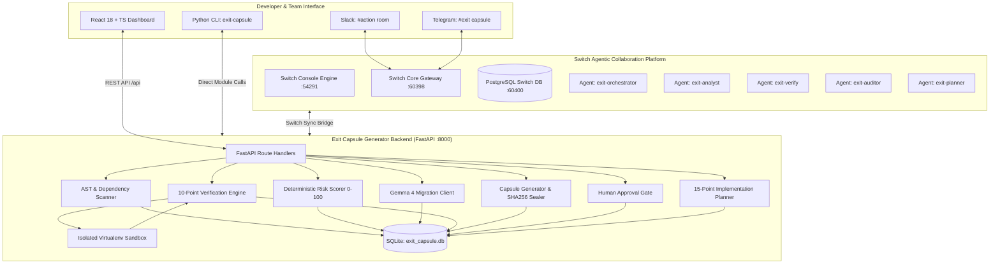

# ARCHITECTURE AUDIT: EXIT CAPSULE GENERATOR
**Date:** 2026-11-07  
**Auditor:** Lead AI Engineer & Technical Architect  
**Project:** Exit Capsule Generator (`ancient-skull`)  
**Repository:** https://github.com/ABHISHEK-DBZ/ancient-skull  

---

## 1. Executive Summary

The **Exit Capsule Generator** codebase represents a robust, well-architected foundation designed for dependency intelligence, risk analysis, AI-assisted migration planning, independent verification, and capsule generation. 

The core philosophy—***"AI proposes. The tool verifies. The developer approves. Tests provide evidence."***—is embedded across the backend services. The backend test suite is 100% passing (29/29 tests), and the frontend TypeScript compilation and unit tests (6/6 tests) succeed without regressions.

However, a comprehensive Phase Zero audit reveals critical integration gaps between the core tool and the **Switch Multi-Agent Workforce**, missing UI views required for developer experience (AI Workforce, Audit Logs, dedicated Human Approval workflow), and an opportunity to harden the cryptographic binding between human approvals and exact capsule version hashes.

---

## 2. System Architecture & Component Mapping

---

## 3. Subsystem Deep-Dive Audit

### 3.1 Repository Intelligence & Static AST Scanner
- **Files:** `backend/app/scanner/ast_analyzer.py`, `backend/app/scanner/discovery.py`, `backend/app/scanner/package_mappings.py`, `backend/app/scanner/git_fetcher.py`.
- **Implementation Reality:**
  - Manifest parsing supports `requirements*.txt`, `pyproject.toml` (PEP 621, Poetry, Flit).
  - PEP 503 package normalization is strictly applied (`normalize_package_name`).
  - AST analysis runs via Python's native `ast` standard library—**zero repository code execution** during scanning.
  - Captures exact file paths, line numbers, imported aliases, referenced symbols, call expressions, and enclosing function/class scopes (`ScopeVisitor`).
  - Filters out Python standard library modules (`is_stdlib_module`) and detected local workspace modules (`get_local_project_modules`).
- **Strengths:** 
  - Pure deterministic static analysis. Safe against malicious payloads in user repositories.
  - Rich AST context is captured for evidence ledgers and bounded LLM prompting.
- **Identified Limitations:**
  - Does not currently resolve star imports (`from module import *`).
  - Dynamic imports via `__import__` or `importlib.import_module` are flagged with `is_uncertain: true`, which is appropriate, but transitive symbol tracking through custom wrapper functions is limited.

### 3.2 Dependency Risk Intelligence Engine
- **Files:** `backend/app/metadata/risk_scorer.py`, `backend/app/metadata/pypi_client.py`.
- **Implementation Reality:**
  - Fetches authentic release and package metadata from the PyPI JSON API (`https://pypi.org/pypi/<package>/json`) with timeout and error handling.
  - Computes a deterministic 0–100 risk score based on explainable factors:
    1. **Missing PyPI Metadata:** Score 30.0 (High uncertainty).
    2. **Yanked Release:** Score 40.0.
    3. **Release Age / Inactivity:** >3 years: 30.0; >2 years: 20.0; >1 year: 10.0.
    4. **Version Lag:** Major version lag: 25.0; Minor lag: 15.0.
    5. **Python Compatibility:** Deprecated runtime markers (<3.8): 20.0.
  - Scores are classified into `LOW` (0–29), `MEDIUM` (30–59), `HIGH` (60–79), and `CRITICAL` (80–100).
- **Strengths:** Never invents or hallucinates vulnerabilities or release metadata. Every point is backed by a specific factor and URL evidence.
- **Identified Limitations:** Currently lacks an in-memory or SQLite TTL cache for PyPI queries, causing redundant network requests during repeated scans.

### 3.3 AI Migration Engine (Gemma 4 Adapter)
- **Files:** `backend/app/ai/gemma_client.py`, `backend/app/ai/schemas.py`.
- **Implementation Reality:**
  - Bounded prompt builder: sends package name, risk factors, Python constraints, and at most 10 AST usage snippets—**never the full codebase**.
  - Strict validation: verifies that the configured model belongs to the Gemma family (`validate_gemma_model_name`).
  - Robust JSON extraction (`extract_json_from_text`): strips reasoning tags, handles markdown code fences, and uses raw JSON decoder fallback.
  - Fully optional: If `GEMMA_API_KEY` is not present, the tool functions 100% deterministically.
- **Strengths:** Strong schema validation with Pydantic (`GemmaMigrationProposal`). Strict model identity gating prevents accidental non-Gemma model substitution.
- **Identified Limitations:** In offline environments without local Ollama, automated proposal fallback relies on manual input from the user or pre-verified mapping heuristics.

### 3.4 Independent 10-Point Verification Engine
- **Files:** `backend/app/verification/engine.py`, `backend/app/verification/isolated_env.py`, `backend/app/verification/test_runner.py`, `backend/app/verification/api_compat.py`.
- **Implementation Reality:**
  - Complete 10-point check suite:
    1. Candidate package existence on PyPI.
    2. Compatible release availability (non-yanked).
    3. Python version constraints check.
    4. Isolated virtual environment installation (`IsolatedEnvironment`).
    5. Exported symbol inspection (imports module inside venv, extracts `dir(mod)`).
    6. API usage compatibility check (matches observed symbols against candidate exports).
    7. Baseline test execution on isolated working copy (`IsolatedRepositoryCopy`).
    8. Replacement environment test execution status tracking.
    9. Like-for-like test outcome comparison.
    10. AI claim reconciliation (compares AI claims against empirical results).
  - All commands execute with `shell=False`, strict timeouts, and byte output truncation.
- **Strengths:** True empirical verification. Proves whether a proposed replacement actually installs and provides the needed APIs.
- **Identified Limitations:**
  - Check 8 (Replacement test execution) currently sets status to `NOT_RUN` pending developer approval; it should support ephemeral speculative dry-run testing in a completely isolated branch/copy when requested.

### 3.5 Dependency Exit Capsule & Evidence Ledger
- **Files:** `backend/app/capsule/generator.py`, `backend/app/capsule/markdown_builder.py`, `backend/app/capsule/schema.py`.
- **Implementation Reality:**
  - Generates both `capsule.json` and a richly formatted `capsule.md`.
  - Implements an immutable **Evidence Ledger** classifying every claim: `observed`, `executed`, `verified`, `ai_suggested_unverified`, `rejected`, `inconclusive`, `not_run`.
  - Implements cryptographic SHA256 sealing: `capsule_sha256` covers the entire JSON payload, and `previous_seal_sha256` links versions chronologically (`v1/`, `v2/`, etc.).
- **Strengths:** Tamper-evident audit trail with dual JSON and Markdown delivery.

### 3.6 Human Approval Gate & Implementation Planning
- **Files:** `backend/app/routes/approval.py`, `backend/app/planner/implementation_planner.py`, `backend/app/planner/agent_prompt_builder.py`.
- **Implementation Reality:**
  - Explicit approval gate: Developer must explicitly submit `APPROVED` or `REJECTED` with optional notes.
  - On approval, re-assembles the capsule and unlocks the **15-Point Implementation Plan** and AI agent prompt directive.
- **Critical Gap:** The current `ApprovalRequest` payload and DB record do not strictly tie the approval decision to the specific `capsule_sha256` and `capsule_version` being reviewed. A malicious or accidental replay across versions must be cryptographically prevented.

---

## 4. Switch Collaboration Layer Audit

Switch Console and Switch Core are actively running on the host system:
- **Switch Console Process:** PID 9620 (Electron host)
- **Switch Core Process:** PID 45996 (Python 3.12, version 0.31.0)
- **Control API:** `http://127.0.0.1:54291` (authenticated with `X-Switch-Control-Token`)
- **Switch Gateway API:** `http://127.0.0.1:60398`
- **PostgreSQL Database:** Port 60400 (`switch` database)

### 4.1 Switch Rooms Audit
1. **`exit capsule: dependencey-war-room`** (UUID: `be077a33-8063-4679-983a-e2106a34e508`):
   - Connected to Telegram Bridge (`d9fd4c62-1365-43a2-8f31-1dc5ba44457e`).
   - Notice: Agents have not yet been granted membership to this room (`room_agents` has 0 rows for this room).
2. **`action`** (UUID: `29ef14a7-572f-46d9-8d59-883d13b70f35`):
   - Connected to **Slack Bridge** (`78a6b1b1-ae48-4737-8403-5e678c18813c`, active).
   - All active agents are registered members in this room:
     - `exit-orchestrator`
     - `exit-analyst`
     - `exit-verify`
     - `exit-auditor`
     - `exit-planner`
   - Real messages and joins from user `abhibro936` and agents are recorded.

### 4.2 Switch Agents Audit
| Agent Name | Agent UUID | Role in Switch | Real Registered State |
|---|---|---|---|
| `exit-orchestrator` | `cc70db26-fba8-4e68-9679-a6bffe723954` | Project Coordination | Registered & Active |
| `exit-analyst` | `840c4049-8e8f-412f-a356-f0d9dd945753` | Dependency Health & AST Analysis | Registered & Active |
| `exit-verify` | `17526868-1778-4e73-84c4-374e1de5e474` | Independent Verification | Registered & Active (named `exit-verify`) |
| `exit-auditor` | `766d0871-b5b8-4f63-952f-6ad18fcbb3ec` | Security & Capsule Auditing | Registered & Active |
| `exit-planner` | `4fcf1193-95af-450d-83bb-29452a4e3c2b` | 15-Point Implementation Planning | Registered & Active |
| `exit-architect` | **Missing** | Architecture & Migration Strategy | **NOT REGISTERED** in Switch |

### 4.3 Integration Reality
The Exit Capsule Generator backend currently operates as a standalone service without an active bridge communicating with the Switch Gateway or PostgreSQL store. To make Switch collaboration real and verifiable:
1. Backend must provide a Switch Client module (`app/switch/client.py`) that queries real agent status, posts scan and verification milestones to the Slack/action room, and receives task triggers.
2. The UI must include an **AI Workforce Dashboard** displaying live Switch agents, room connectivity, recent agent actions, and task status.
3. The missing agent `exit-architect` must be documented and onboarded in Switch, and the naming between `exit-verifier` and `exit-verify` must be normalized.

---

## 5. Security Architecture Audit
- **Subprocess Isolation:** `execute_isolated_command` executes with `shell=False`, strict timeouts, and array arguments.
- **Path Traversal Prevention:** `safe_repo_path` validates that repository paths resolve cleanly within allowed bounds and prevents traversal attacks.
- **Secret Redaction:** `redact_secrets` scrubs API keys and tokens before logging, writing to database, or emitting capsules.
- **Git Credential Purging:** `purge_legacy_git_credentials` strips embedded credentials from stored git remote URLs on startup.
- **Host Protection:** Code under verification is never run directly in the host Python environment; ephemeral virtual environments are used.

