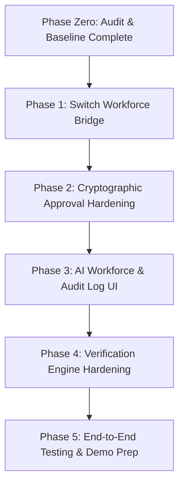

# DEVELOPMENT ROADMAP: EXIT CAPSULE GENERATOR
**Date:** 2026-11-07  
**Version:** 1.0 (Hackathon Execution Plan)  
**Project:** Exit Capsule Generator (`ancient-skull`)  

---

## 1. Specialist Agent Role Allocation

Each phase and task is explicitly owned by one of the six designated specialist roles in the **Switch Multi-Agent Workforce**:

1. **`exit-orchestrator`** (Coordination, Task Assignment, Blocker Resolution)
2. **`exit-analyst`** (AST Analysis, Manifest Parsing, Risk Scoring)
3. **`exit-architect`** (Migration Strategies, Gemma 4 Integration, System Design)
4. **`exit-verifier` / `exit-verify`** (Sandbox Testing, Ephemeral Virtualenvs, Compatibility Checks)
5. **`exit-auditor`** (Cryptographic Sealing, Evidence Ledger, Security Review)
6. **`exit-planner`** (15-Point Action Plans, Human Approval Gate, Agent Directives)

---

## 2. Phased Execution Roadmap

### Phase 1: Switch Multi-Agent Collaboration Bridge
* **Lead Agent:** `exit-orchestrator`
* **Assisting Agents:** `exit-auditor`, `exit-planner`
* **Tasks:**
  1. **Audit & Register Agent Fleet:** Confirm live status of `exit-orchestrator`, `exit-analyst`, `exit-verify`, `exit-auditor`, `exit-planner`. Onboard `exit-architect` into Switch PostgreSQL agent registry.
  2. **Build Switch Client Service (`backend/app/switch/client.py`):**
     - Query Switch PostgreSQL and Switch Core Gateway for real-time agent presence and room metadata.
     - Post structured event messages into the Slack-bridged room (`action` room / `dependency-war-room`).
  3. **Expose Switch REST API (`backend/app/routes/switch_route.py`):**
     - `GET /api/switch/workforce`: Returns list of registered Switch agents, their current status, roles, and assigned tasks.
     - `GET /api/switch/rooms`: Returns connected collaboration rooms and bridge status (Slack, Telegram).
     - `POST /api/switch/notify`: Dispatches scan milestones, verification results, and approval events to the room.
* **Verification Gate:**
  - Automated tests verifying Switch client query and message formatting.
  - Live message verified in Slack `#action room`.

---

### Phase 2: Cryptographic Approval Gate & Tamper-Evident Binding
* **Lead Agent:** `exit-auditor`
* **Assisting Agents:** `exit-planner`, `exit-architect`
* **Tasks:**
  1. **Schema & Model Updates (`backend/app/models/schemas.py`):**
     - Extend `ApprovalRequest` to require `capsule_sha256` (64-char hex) and `capsule_version` (int).
  2. **Approval Route Hardening (`backend/app/routes/approval.py`):**
     - Validate that the submitted `capsule_sha256` exactly matches the active version in `capsule_versions`.
     - Reject approvals if the capsule has been re-generated or tampered with since review.
     - Record approved hash, version, and reviewer notes in `approval_decisions` and `approval_history`.
  3. **Cryptographic Integrity Endpoint (`backend/app/routes/capsule.py`):**
     - `POST /api/scans/{scan_id}/capsule/verify-hash`: Re-computes SHA256 over `capsule.json` payload and verifies it against the stored seal and version chain.
* **Verification Gate:**
  - `test_approval_planner.py` updated to verify hash-mismatch rejection and valid approval sealing.

---

### Phase 3: Developer Dashboard Expansion (AI Workforce & Audit Logs)
* **Lead Agent:** `exit-architect`
* **Assisting Agents:** `exit-orchestrator`, `exit-analyst`
* **Tasks:**
  1. **Build `frontend/src/pages/WorkforcePage.tsx`:**
     - Displays all 6 Switch specialist agents with their real registration status, UUID, avatar/role badge, and live activity.
     - Displays connected collaboration rooms (Slack `#action room` and Telegram).
     - Displays active task queue and recent collaboration events.
     - Includes direct "Send Ping to Room" action to test agent responsiveness.
  2. **Build `frontend/src/pages/AuditLogsPage.tsx`:**
     - Displays immutable event stream: Scan Initiated, Risk Scored, AI Proposal Formulated, 10-Point Verification Executed, Capsule Sealed (with SHA256), Developer Approved.
  3. **Update `AppShell.tsx` and Navigation:**
     - Add `AI Workforce` and `Audit Logs` to sidebar navigation.
     - Add route handlers and URL state synchronization in `App.tsx`.
  4. **Dedicated Human Approval Action Component:**
     - Highlight the cryptographic capsule SHA256 badge in the approval modal.
* **Verification Gate:**
  - `tsc --noEmit` clean.
  - Vitest frontend tests passing.
  - Vite production build succeeds.

---

### Phase 4: AST Analyzer & Verification Engine Hardening
* **Lead Agent:** `exit-verifier`
* **Assisting Agents:** `exit-analyst`
* **Tasks:**
  1. **PyPI Metadata Caching (`backend/app/metadata/pypi_client.py`):**
     - Add local in-memory/file cache for PyPI queries to prevent rate-limiting during large scans.
  2. **Sandbox Speculative Patch Execution (Verification Check 8):**
     - In `backend/app/verification/engine.py`, enable dry-run code replacement in ephemeral `IsolatedRepositoryCopy` to test whether test suite passes with proposed replacement package.
  3. **AST Detection Refinement:**
     - Handle `from module import *` with explicit warning annotation in AST usage report.
* **Verification Gate:**
  - Pytest verification suite confirms Check 8 execution in temporary sandbox without touching host files.

---

### Phase 5: End-to-End Verification, LinkWatch Demo & Presentation
* **Lead Agent:** `exit-orchestrator`
* **Assisting Agents:** All specialist agents
* **Tasks:**
  1. **Run Full End-to-End Scan on `LinkWatch` Test Fixture:**
     - Scan repo `backend/tests/fixtures/sample_project`.
     - Detect declared dependencies (`requests`, `pyyaml`).
     - Calculate deterministic risk scores.
     - Generate Gemma 4 migration proposal (`requests` -> `httpx`).
     - Execute 10-point independent verification in ephemeral venv.
     - Generate sealed `capsule.json` and `capsule.md` with SHA256 digest.
     - Execute developer approval tied to capsule SHA256.
     - Generate 15-point implementation plan and AI agent prompt directive.
     - Run post-verification unified diff check.
  2. **Verify Switch Collaboration:**
     - Verify notifications posted to Slack room.
     - Verify all 6 agents visible and green in Workforce UI.
  3. **Prepare Hackathon Demonstration Script:**
     - Document step-by-step developer walkthrough for judges.
* **Verification Gate:**
  - Zero mock data.
  - Zero broken buttons.
  - 100% real backend data and verified cryptographic seals.

---

## 3. Execution Status (2026-11-07)

| Phase | Status | Notes |
|---|---|---|
| Phase 0 — Audit & baseline | COMPLETE | Recon and baseline recorded. |
| Phase 1 — Switch bridge | COMPLETE AND VERIFIED | Client, status/rooms/notify routes, audit logs, best-effort milestone posts, failure-path tests. Live Slack post confirmed. |
| Phase 2 — Cryptographic approval | COMPLETE AND VERIFIED | SHA-256 + version binding, 409 on stale capsule, reseal on approval, verify-hash tamper detection. |
| Phase 3 — Workforce & audit UI | COMPLETE AND VERIFIED | `WorkforcePage`, `AuditLogsPage`, navigation, capsule verify button, live screenshot QA, 8 frontend tests. |
| Phase 4 — Analyzer/verification hardening | NOT STARTED | PyPI cache, speculative Check 8, `import *` refinement remain roadmap items. |
| Phase 5 — End-to-end demo | PARTIAL | Scan?capsule?approval?plan?audit flow verified; `exit-architect` live session and GitHub OAuth need operator action. |

**Verification command:** `cd backend && python -m pytest -q` ? 49 passed; `cd frontend && npx tsc --noEmit && npx vitest run && npx vite build` ? clean.
